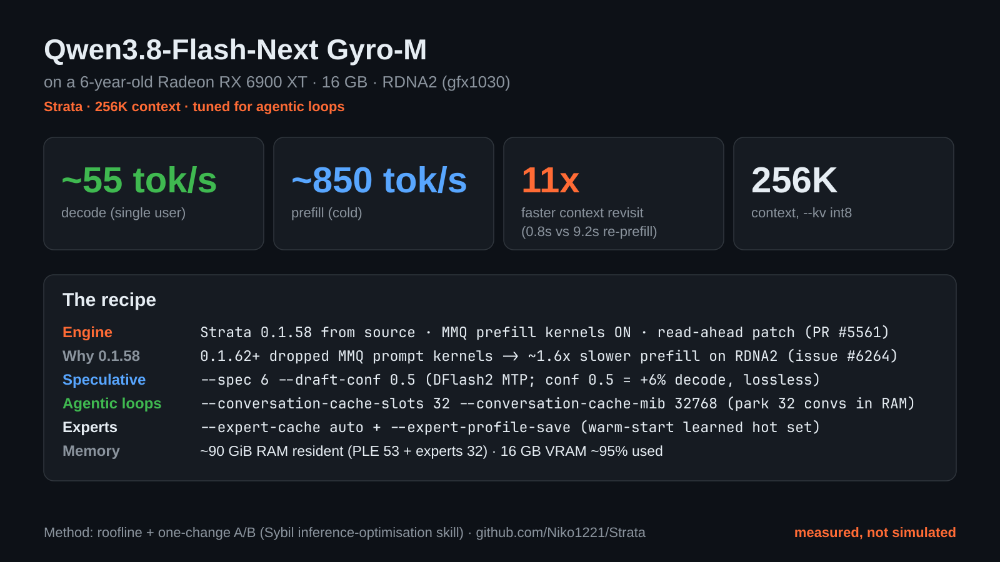

# Strata · Qwen3.8-Flash-Next Gyro-M on a 6-year-old RX 6900 XT (16 GB, RDNA2)

A tuned local-LLM recipe for the gfx1030 card. 256K context, agentic-loop friendly.
Tuned with the roofline + one-change-at-a-time A/B method (Sybil `inference-optimisation` skill).

## Hardware
- **GPU:** RX 6900 XT 16 GB (gfx1030, RDNA2) — PCIe 4.0 x16
- **CPU/RAM:** Ryzen 9 9950X, **~96 GB DDR5** (engine resident set ~90 GiB)
- **Storage:** model on NVMe / RAID (fast random read helps expert-cache misses)
- **OS:** Linux, ROCm 7

## Model
Qwen3.8-Flash-Next **Gyro-M** (TQ2_0 pack, ~92 GB on disk). 512 experts, top-10 + 1 shared, 48 layers.

## Build (the important part on RDNA2)
Strata engine **0.1.58** compiled from source for gfx1030:
```
-DSTRATA_PREFILL_MMQ=ON -DSTRATA_MMQ_KQUANTS=ON
```
plus the sequential expert read-ahead patch (PR #5561).

> Do **not** update past 0.1.58 on RDNA2. 0.1.62+ dropped llama.cpp's MMQ prompt kernels;
> the replacement needs matrix cores gfx1030 lacks, so every layer falls back to a slower
> FP16 path (~1.6x slower prefill). See issue #6264.

## Launch flags
```
--kv int8 --kv-resident 131072                 # 256K context, half the KV resident in VRAM
--expert-cache auto                            # fills VRAM (~5638 experts resident, ~80% decode hit)
--spec 6 --draft-conf 0.5                       # DFlash2 MTP drafter; conf 0.5 measured +6% here (lossless)
--conversation-cache-slots 32 --conversation-cache-mib 32768   # park 32 conversations in RAM
--expert-profile-save <file.bin>                # persist the learned hot-expert set -> warm start
# optional: --control-vector-scaled <vec>:1.0 --control-vector-layer-range 4 44 --cvec-mode project --cvec-dir per-layer
env: STRATA_HIP_PROMPT_F16=1 STRATA_PCIE_FRAC_DEFAULT=auto STRATA_EXPERTS_SEQ_READAHEAD=1
```

## Measured (this card)
| Metric | Result |
|---|---|
| Decode (short) | ~55 tok/s |
| Decode @ 86K-137K ctx | 53-55 tok/s |
| Prefill (cold) | ~850 tok/s |
| Agentic context revisit | **0.8 s** vs 9.2 s re-prefill (**11x**) via the conversation cache |
| RAM resident | ~90 GiB (PLE table 53 GiB + expert arena 32 GiB) |
| VRAM | 16 GB, ~95% used, stable |

## What moved the needle (A/B tested)
- **`--draft-conf 0.5`**: +6% decode vs the auto 0.7 (lossless at temp 0).
- **Big conversation cache (32 slots)**: 11x faster context switches in agentic loops — the biggest practical win.
- **`--expert-profile-save`**: warm-start from your own learned hot-expert set.
- Rejected after interleaved A/B: memlock (no RAM pressure), hugepages (already PMD-mapped), smaller kv-resident (no gain).
- RAM overclock: won't help — host path is PCIe 4.0 (28.5 GB/s) capped; decode is VRAM-bound, prefill is GPU-compute-bound.
